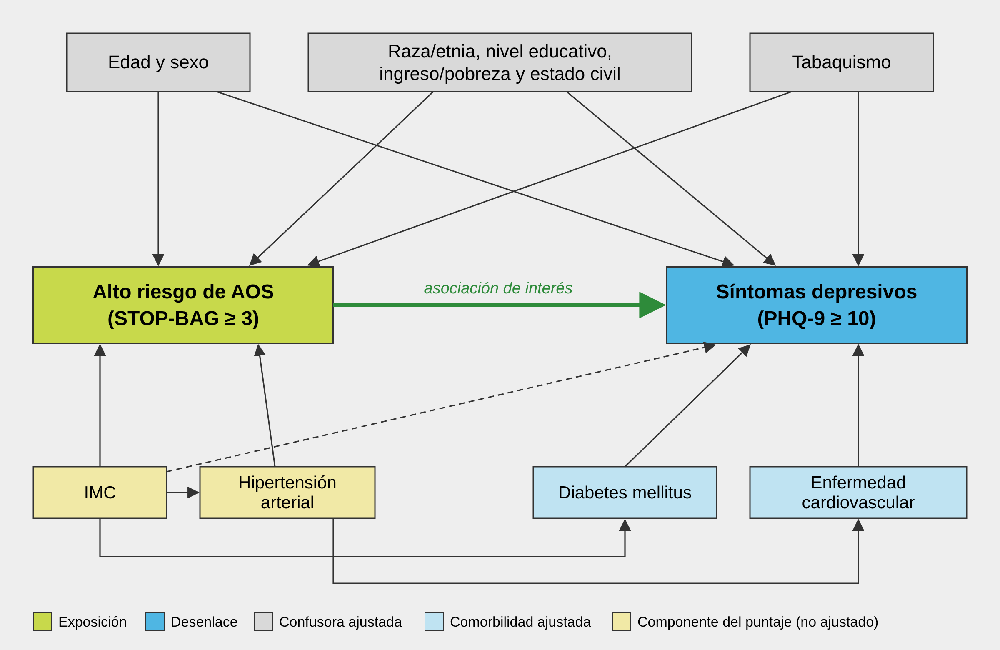

# 1. Introducción

La apnea obstructiva del sueño (AOS) es un trastorno respiratorio caracterizado por episodios repetidos de obstrucción de la vía aérea superior durante el sueño, que producen hipoxia intermitente y fragmentación del sueño (2). Se estima que afecta a cerca de 936 millones de adultos de 30 a 69 años en el mundo, de los cuales 425 millones tendrían una forma moderada a grave (1). Una gran proporción de estos casos permanece sin diagnóstico, porque la polisomnografía es costosa y de acceso limitado (1,2).

La depresión es uno de los trastornos mentales más frecuentes y una de las principales causas de discapacidad en el mundo; la Organización Mundial de la Salud estima que afecta a más de 280 millones de personas (3). En estudios poblacionales, los síntomas depresivos suelen medirse con el Cuestionario de Salud del Paciente de 9 ítems (PHQ-9), cuyo punto de corte de 10 o más tiene una sensibilidad y una especificidad de 88% para depresión mayor (4).

Existen mecanismos plausibles que vinculan ambas condiciones. La hipoxia intermitente, la fragmentación del sueño, la inflamación sistémica y la somnolencia diurna podrían afectar el estado de ánimo y la función cognitiva (5,7). En la cohorte de Wisconsin, el empeoramiento de los trastornos respiratorios del sueño se asoció con un mayor riesgo de desarrollar depresión (5). En NHANES 2005–2008, la frecuencia de ronquidos con resoplidos o pausas respiratorias durante el sueño se asoció con depresión probable según el PHQ-9 (6), y en un análisis de los ciclos 2005 a 2018, la AOS autorreportada se asoció con mayor probabilidad de síntomas depresivos (26). Asimismo, las revisiones sistemáticas reportan una elevada frecuencia de síntomas depresivos en pacientes con AOS y de AOS en pacientes con depresión (7,8).

El cuestionario STOP-BANG es una herramienta de tamizaje breve, validada y ampliamente usada para identificar a personas con alto riesgo de AOS, compuesta por ocho ítems dicotómicos: ronquido, cansancio, apneas observadas, presión arterial alta, índice de masa corporal, edad, circunferencia de cuello y sexo (9). La Encuesta Nacional de Salud y Nutrición de Estados Unidos (NHANES) 2017–marzo 2020 incluye preguntas sobre la frecuencia de ronquido, de resoplidos o pausas respiratorias y de somnolencia diurna, además de datos de presión arterial, índice de masa corporal, edad y sexo, y el PHQ-9 (10–12). Esta combinación permite construir una versión adaptada del STOP-BANG y evaluar su asociación con síntomas depresivos en una muestra representativa a nivel nacional.

Esta asociación ya fue explorada con el STOP-BANG en la Encuesta Nacional de Salud y Nutrición de Corea (KNHANES). En 8,030 adultos de la edición 2019–2020, el alto riesgo de AOS se asoció con mayor probabilidad de síntomas depresivos según el PHQ-9 (OR 4.31) (22), y en 4,352 adultos de 40 años o más de la edición 2020, con puntajes más altos de PHQ-9 en ambos sexos (23). Sin embargo, estos hallazgos provienen de una población étnicamente homogénea, con una prevalencia de obesidad y una distribución de factores de riesgo distintas a las de poblaciones multiétnicas como la estadounidense o la latinoamericana.

# 2. Justificación

La justificación de este estudio se apoya en tres ejes.

**Magnitud del problema.** La AOS y la depresión son condiciones frecuentes, ambas subdiagnosticadas y con un impacto importante en la calidad de vida, la productividad y el uso de servicios de salud (1,3). Si el alto riesgo de AOS se asocia con síntomas depresivos, una parte de estos podría estar relacionada con un trastorno del sueño tratable que pasa desapercibido.

**Vacío de conocimiento.** La asociación entre el alto riesgo de AOS según el STOP-BANG y los síntomas depresivos se ha descrito en encuestas nacionales de Corea (22,23), pero no se ha confirmado en poblaciones multiétnicas. En Estados Unidos, los estudios en NHANES evaluaron síntomas aislados de AOS o su autorreporte: con datos de 2005–2008, los resoplidos o pausas respiratorias frecuentes se asociaron con depresión probable (6), y con datos combinados de 2005 a 2018, la AOS autorreportada se asoció con síntomas depresivos (OR 2.36) (26). En la literatura revisada para este protocolo no se identificó un estudio que evalúe esta asociación con un puntaje compuesto de tamizaje basado en el STOP-BANG, que incluya los datos de 2019–2020 del archivo prepandémico, el último con preguntas sobre síntomas de AOS (11,16), ni que la examine específicamente en adultos hispanos, cuyo perfil es más cercano al de la población latinoamericana.

**Utilidad práctica.** El STOP-BANG es una herramienta sencilla que puede aplicarse en la atención primaria (9). Demostrar su asociación con síntomas depresivos apoyaría un tamizaje cruzado: buscar síntomas depresivos en personas con alto riesgo de AOS y evaluar el riesgo de AOS en personas con depresión. Además, el uso de una base de datos pública permite realizar el estudio en un tiempo corto, sin costos de recolección y con una muestra representativa.

**Relevancia para el Perú.** En el Perú no existe una encuesta nacional que incluya preguntas sobre síntomas de AOS: la Encuesta Demográfica y de Salud Familiar (ENDES) incluye el PHQ-9, pero no preguntas sobre ronquido, apneas observadas ni somnolencia. Por ello, el análisis del subgrupo de adultos hispanos de NHANES ofrece la evidencia poblacional disponible más cercana a la población peruana, y sus resultados podrán justificar la inclusión de estas preguntas en encuestas nacionales y el diseño de estudios primarios en el país.

# 3. Problema de investigación

## 3.1 Planteamiento del problema

La AOS y la depresión comparten síntomas, factores de riesgo y posibles mecanismos fisiopatológicos, pero ambas suelen evaluarse por separado en la práctica clínica (5–8). La evidencia poblacional con el STOP-BANG proviene principalmente de Corea (22,23), y la evidencia en Estados Unidos, del autorreporte o de síntomas aislados de AOS en NHANES (6,26). No se conoce con precisión si el alto riesgo de AOS, definido mediante un puntaje compuesto de tamizaje, se asocia con síntomas depresivos clínicamente relevantes en una muestra nacional multiétnica y reciente, ni si esta asociación se mantiene en adultos hispanos, después de considerar las características sociodemográficas y clínicas de los participantes.

## 3.2 Formulación de la pregunta de investigación

En adultos de 20 años o más participantes de NHANES 2017–marzo 2020, ¿el alto riesgo de AOS según una versión adaptada del cuestionario STOP-BANG se asocia con la presencia de síntomas depresivos clínicamente relevantes?

## 3.3 Estructura PECO

| Componente | Definición |
| --- | --- |
| **Población (P)** | Adultos de 20 años o más que participaron en NHANES 2017–marzo 2020, con información completa del cuestionario de sueño (P_SLQ) y del PHQ-9 (P_DPQ). |
| **Exposición (E)** | Alto riesgo de AOS: puntaje de 3 o más en la versión adaptada del STOP-BANG (STOP-BAG, 0 a 7 puntos). |
| **Comparación (C)** | Bajo riesgo de AOS: puntaje de 0 a 2. |
| **Desenlace (O)** | Síntomas depresivos clínicamente relevantes: puntaje PHQ-9 de 10 o más. |

## 3.4 Nota sobre la naturaleza secundaria del estudio

Este protocolo no plantea el reclutamiento de participantes ni la aplicación de instrumentos propios. La población de estudio ya fue evaluada por el National Center for Health Statistics (NCHS) de Estados Unidos entre 2017 y marzo de 2020, y sus microdatos están disponibles públicamente (10). Por ello, no se requiere una fase de recolección primaria de información, y la disponibilidad de los datos permite verificar la factibilidad antes del análisis estadístico final.

# 4. Objetivos

## 4.1 Objetivo general

Determinar la asociación entre el alto riesgo de AOS, según una versión adaptada del cuestionario STOP-BANG, y los síntomas depresivos clínicamente relevantes en adultos de 20 años o más, según NHANES 2017–marzo 2020.

## 4.2 Objetivos específicos

- Describir las características sociodemográficas y clínicas de la población de estudio según su nivel de riesgo de AOS.
- Estimar la prevalencia ponderada del alto riesgo de AOS y de los síntomas depresivos clínicamente relevantes.
- Estimar las razones de prevalencia crudas y ajustadas de síntomas depresivos clínicamente relevantes entre los participantes con alto y bajo riesgo de AOS.
- Evaluar la existencia de un gradiente en la prevalencia de síntomas depresivos según el puntaje del STOP-BANG adaptado (0–2, 3–4 y 5–7 puntos).
- Evaluar la consistencia de la asociación con una versión reducida del STOP-BANG validada frente a la polisomnografía (SOPBAG) y con el índice multivariable de predicción de apnea (MAP).
- Estimar la asociación en el subgrupo de adultos hispanos.
- Explorar si la asociación difiere según el sexo.

# 5. Hipótesis

**Hipótesis nula (H0):** no existe asociación entre el alto riesgo de AOS según la versión adaptada del STOP-BANG y los síntomas depresivos clínicamente relevantes en adultos de 20 años o más, según NHANES 2017–marzo 2020.

**Hipótesis alterna (H1):** el alto riesgo de AOS según la versión adaptada del STOP-BANG se asocia con una mayor prevalencia de síntomas depresivos clínicamente relevantes en adultos de 20 años o más, según NHANES 2017–marzo 2020, independientemente de las características sociodemográficas y clínicas evaluadas.

# 6. Metodología

## 6.1 Diseño de estudio

Estudio observacional, analítico, de corte transversal, mediante análisis secundario de los datos de NHANES 2017–marzo 2020, que emplea un diseño de muestreo probabilístico complejo, estratificado y multietápico (10,15). El ciclo 2019–2020 se interrumpió en marzo de 2020 por la pandemia de COVID-19; por ello, el NCHS combinó sus datos con los del ciclo 2017–2018 en un archivo prepandémico representativo a nivel nacional, con pesos muestrales propios (10,15). El reporte del estudio seguirá la guía STROBE para estudios observacionales (13).

Se optó por este ciclo porque es el más reciente que incluye preguntas sobre síntomas de AOS: en el ciclo agosto 2021–agosto 2023, el cuestionario de sueño solo registró los horarios habituales de sueño (16).

## 6.2 Población

**Población diana:** adultos de 20 años o más de la población civil no institucionalizada de Estados Unidos.

**Población accesible:** participantes de NHANES 2017–marzo 2020 de 20 años o más que completaron la entrevista domiciliaria y el examen en el Centro de Examen Móvil (MEC), donde se aplicó el PHQ-9 (12).

## 6.3 Criterios de inclusión

- Tener 20 años o más al momento de la entrevista (RIDAGEYR ≥ 20).
- Haber sido examinado en el MEC (RIDSTATR = 2).
- Tener respuestas válidas a las tres preguntas de síntomas de sueño usadas para el STOP-BANG adaptado (SLQ030, SLQ040 y SLQ120).
- Tener respuestas válidas (0 a 3) a los nueve ítems del PHQ-9 (DPQ010 a DPQ090).

## 6.4 Criterios de exclusión

- Mujeres embarazadas al momento del examen (RIDEXPRG = 1), porque el embarazo modifica el índice de masa corporal y el riesgo de síntomas depresivos.
- Respuestas "No sabe" o "Rechazado" en las variables que componen la exposición o el desenlace.
- Datos faltantes en alguna de las covariables del modelo ajustado. El análisis principal será de casos completos.

## 6.5 Variables y operacionalización

### 6.5.1 Variable de exposición: alto riesgo de AOS

Se construirá una versión adaptada del STOP-BANG con los siete ítems disponibles en NHANES 2017–marzo 2020 (9). El ítem de circunferencia de cuello (N) no puede incluirse porque no se mide en el examen físico de este ciclo, por lo que la escala resultante (STOP-BAG) va de 0 a 7 puntos. Cada ítem positivo suma un punto:

| Ítem | Variable NHANES | Pregunta o medición | Criterio de positividad |
| --- | --- | --- | --- |
| **S** – Ronquido | SLQ030 (P_SLQ) | ¿Con qué frecuencia ronca mientras duerme? | 3 o más noches por semana (códigos 2 y 3) |
| **T** – Cansancio | SLQ120 (P_SLQ) | ¿Con qué frecuencia se siente excesivamente somnoliento durante el día? | 5 o más veces al mes (códigos 3 y 4) |
| **O** – Apneas observadas | SLQ040 (P_SLQ) | ¿Con qué frecuencia resopla, jadea o deja de respirar mientras duerme? | 3 o más noches por semana (códigos 2 y 3) |
| **P** – Presión arterial | BPQ020 (P_BPQ) | ¿Alguna vez un médico le dijo que tiene presión arterial alta? | Respuesta "Sí" (código 1) |
| **B** – IMC | BMXBMI (P_BMX) | Índice de masa corporal medido en el MEC | Mayor de 35 kg/m² |
| **A** – Edad | RIDAGEYR (P_DEMO) | Edad en años cumplidos | Mayor de 50 años |
| **G** – Sexo | RIAGENDR (P_DEMO) | Sexo | Masculino (código 1) |

Se considerará **alto riesgo de AOS** un puntaje de 3 o más, y **bajo riesgo** un puntaje de 0 a 2, en concordancia con el punto de corte del cuestionario original (9). Para el análisis de gradiente, el puntaje se agrupará en 0–2, 3–4 y 5–7 puntos. Las respuestas "No sabe" (9) o "Rechazado" (7) se considerarán datos faltantes.

La omisión del cuello tiene respaldo empírico. En 541 pacientes evaluados con polisomnografía, una versión reducida que excluye la circunferencia de cuello y el cansancio (SOPBAG) tuvo un área bajo la curva de 0.811, equivalente a la del STOP-BANG completo (0.809) (24). Por ello, se prespecifican dos definiciones complementarias de la exposición:

- **SOPBAG (exposición secundaria prespecificada):** los ítems S, O, P, B, A y G (0 a 6 puntos), sin el ítem de cansancio. Para mantener la comparabilidad con la exposición principal se usará el punto de corte de 3 o más, y además el puntaje continuo. Esta versión, además de estar validada frente a la polisomnografía, elimina el ítem que se superpone con el PHQ-9.
- **Índice MAP (análisis de sensibilidad):** probabilidad estimada de AOS según la ecuación de Maislin et al., validada frente a la polisomnografía, que combina la frecuencia de síntomas nocturnos (SLQ030 y SLQ040, reescalados a la escala original de 0 a 4), el IMC, la edad y el sexo (25). Se analizará como variable continua (por cada aumento de 0.1) y en terciles.

Ninguna de estas versiones reemplaza la polisomnografía: miden riesgo de AOS y no su diagnóstico, por lo que los resultados se interpretarán siempre en esos términos.

### 6.5.2 Variable de desenlace: síntomas depresivos clínicamente relevantes

Se definirán a partir del PHQ-9 del archivo P_DPQ (4,12). Cada uno de los nueve ítems (DPQ010 a DPQ090) se puntúa de 0 ("para nada") a 3 ("casi todos los días") según la frecuencia de cada síntoma en las dos semanas previas, y la suma va de 0 a 27. Se considerarán **síntomas depresivos clínicamente relevantes** un puntaje total de 10 o más (4). Como variables secundarias se usarán el puntaje total continuo y las categorías de severidad: mínima (0–4), leve (5–9), moderada (10–14), moderadamente grave (15–19) y grave (20–27).

### 6.5.3 Tabla de operacionalización de variables

| Variable | Definición conceptual | Definición operacional | Tipo / Escala | Categorías / Rangos | Unidad |
| --- | --- | --- | --- | --- | --- |
| **Síntomas depresivos clínicamente relevantes (desenlace principal)** | Presencia de síntomas depresivos de intensidad compatible con un episodio depresivo mayor | Puntaje PHQ-9 ≥ 10 (suma de DPQ010 a DPQ090) (4) | Dependiente, cualitativa dicotómica | Sí / No | — |
| **Puntaje PHQ-9 (desenlace secundario)** | Severidad de los síntomas depresivos en las dos semanas previas | Suma de los nueve ítems del PHQ-9 (P_DPQ) | Dependiente, cuantitativa discreta | 0–27; mínima, leve, moderada, moderadamente grave, grave | Puntos |
| **Alto riesgo de AOS: STOP-BAG (exposición principal)** | Probabilidad elevada de AOS según un cuestionario de tamizaje | Puntaje de 0 a 7 con los ítems S, T, O, P, B, A y G (sección 6.5.1); alto riesgo ≥ 3 | Independiente, cualitativa dicotómica; ordinal para el gradiente | Alto (≥ 3) / Bajo (0–2); 0–2, 3–4, 5–7 | — |
| **Alto riesgo de AOS: SOPBAG (exposición secundaria)** | Versión reducida del STOP-BANG validada frente a la polisomnografía (24) | Puntaje de 0 a 6 con los ítems S, O, P, B, A y G; alto riesgo ≥ 3 | Independiente, cualitativa dicotómica | Alto (≥ 3) / Bajo (0–2) | — |
| **Índice MAP (análisis de sensibilidad)** | Probabilidad estimada de AOS según síntomas nocturnos y características antropométricas (25) | Ecuación de Maislin et al. con SLQ030, SLQ040, IMC, edad y sexo | Independiente, cuantitativa continua | 0–1; terciles | — |
| **Edad** | Tiempo de vida del participante | Años cumplidos al momento de la entrevista (RIDAGEYR) | Confusora, cualitativa ordinal | 20–39, 40–59, ≥ 60 | Años |
| **Sexo** | Característica biológica | Registrado en la entrevista (RIAGENDR) | Confusora, cualitativa dicotómica | Masculino / Femenino | — |
| **Raza/etnia** | Grupo racial o étnico autoidentificado | Variable RIDRETH3 | Confusora, cualitativa nominal | Mexicano-americano, otro hispano, blanco no hispano, negro no hispano, asiático no hispano, otra o multirracial | — |
| **Nivel educativo** | Máximo nivel de estudios alcanzado | Variable DMDEDUC2 | Confusora, cualitativa ordinal | Sin secundaria completa / Secundaria completa o superior incompleta / Superior completa | — |
| **Razón ingreso familiar/pobreza** | Ingreso familiar en relación con la línea de pobreza | Variable INDFMPIR | Confusora, cualitativa ordinal | < 1.30 / 1.30–3.49 / ≥ 3.50 / No reportado | Razón |
| **Estado civil** | Situación conyugal del participante | Variable DMDMARTZ | Confusora, cualitativa nominal | Casado o conviviente / Viudo, divorciado o separado / Nunca casado | — |
| **Tabaquismo** | Consumo de cigarrillos a lo largo de la vida | Al menos 100 cigarrillos en la vida (SMQ020) y consumo actual (SMQ040) | Confusora, cualitativa nominal | Nunca fumador / Exfumador / Fumador actual | — |
| **Diabetes mellitus** | Comorbilidad metabólica asociada a AOS y depresión | Diagnóstico médico autorreportado (DIQ010) | Confusora, cualitativa dicotómica | Sí / No | — |
| **Enfermedad cardiovascular** | Antecedente de enfermedad cardiovascular establecida | Insuficiencia cardíaca, enfermedad coronaria, angina, infarto o ACV autorreportados (MCQ160B a MCQ160F) | Confusora, cualitativa dicotómica | Sí / No | — |
| **Seguro de salud** | Cobertura de atención sanitaria | Cobertura actual por seguro o plan de salud (HIQ011) | Confusora, cualitativa dicotómica | Sí / No | — |
| **Índice de masa corporal** | Relación peso-talla asociada a adiposidad | Peso (kg) / talla (m)² medidos en el MEC (BMXBMI) | Componente de la exposición (ítem B); covariable solo en el análisis de sensibilidad | < 25 / 25–29.9 / ≥ 30 | kg/m² |
| **Hipertensión arterial** | Comorbilidad cardiovascular frecuente en AOS | Diagnóstico médico autorreportado (BPQ020) | Componente de la exposición (ítem P); no se ajusta | Sí / No | — |
| **Subgrupo hispano** | Población de origen latinoamericano en Estados Unidos | Mexicano-americano u otro hispano (RIDRETH3 = 1 o 2) | Variable de estratificación, cualitativa dicotómica | Sí / No | — |

En todas las variables, los códigos 7 (rechazado) y 9 (no sabe) se considerarán datos faltantes. La edad, el sexo, la hipertensión y el IMC forman parte del puntaje de exposición; por ello, la hipertensión y el IMC no se incluirán en el modelo principal para evitar un sobreajuste, mientras que la edad y el sexo se mantendrán por su fuerte relación con la depresión, evaluando previamente la colinealidad (sección 6.9).

### 6.5.4 Diagrama acíclico dirigido (DAG)

La selección de las covariables de ajuste se basó en el siguiente diagrama acíclico dirigido, que representa las relaciones causales supuestas entre la exposición, el desenlace y las demás variables:



Las características sociodemográficas y el tabaquismo se consideran confusoras, porque pueden influir tanto en el riesgo de AOS como en los síntomas depresivos, y se incluirán en el modelo ajustado. La diabetes y la enfermedad cardiovascular se asocian con los síntomas depresivos y comparten factores de riesgo con la AOS, por lo que también se ajustarán. El IMC y la hipertensión forman parte del puntaje de exposición; ajustarlos en el modelo principal eliminaría parte de la variación que define la exposición, por lo que el IMC se evaluará solo en un análisis de sensibilidad (línea discontinua).

## 6.6 Muestreo y tamaño de muestra

### 6.6.1 Naturaleza de la muestra en un estudio secundario

No se realizará un cálculo de tamaño de muestra orientado al reclutamiento, porque la muestra ya está determinada por el diseño y la ejecución de NHANES 2017–marzo 2020 (15). La población analítica estará constituida por todos los participantes que cumplan los criterios de selección. La evaluación de factibilidad se orientará a verificar, con los datos reales, el número de participantes disponibles, la frecuencia de la exposición y del desenlace, y el número de eventos por parámetro del modelo ajustado.

### 6.6.2 Verificación con datos reales de NHANES 2017–marzo 2020

Se descargarán los archivos públicos P_DEMO, P_SLQ, P_DPQ, P_BPQ, P_BMX, P_DIQ, P_MCQ, P_SMQ y P_HIQ desde el repositorio oficial del CDC y se aplicarán de forma secuencial los criterios de selección. El flujo de participantes se reportará así:

| Paso | Participantes (n) | Excluidos (n) |
| --- | --- | --- |
| Participantes del archivo P_DEMO | 15,560 | — |
| De 20 años o más | 9,232 | 6,328 |
| Examinados en el MEC | 8,544 | 688 |
| Sin embarazo al momento del examen | 8,457 | 87 |
| Con puntaje STOP-BAG válido | 7,435 | 1,022 |
| Con PHQ-9 completo (población analítica) | 6,938 | 497 |
| Con covariables completas (análisis de casos completos) | 6,885 | 53 |

La población analítica quedó constituida por 6,938 participantes. La principal causa de exclusión fue la falta de un puntaje STOP-BAG válido (1,022 participantes), sobre todo por respuestas "No sabe" a la pregunta de ronquido (SLQ030), lo que podría reflejar a personas que duermen solas. La razón ingreso/pobreza no estuvo disponible en 872 participantes (12.6%), que se analizarán como una categoría propia ("no reportado") para no reducir la muestra.

De los 6,938 participantes, 3,222 (46.4%) tuvieron alto riesgo de AOS y 597 (8.6%) síntomas depresivos clínicamente relevantes. La prevalencia ponderada del alto riesgo de AOS fue 42.6% (IC 95%: 39.8% a 45.5%; efecto de diseño 5.31) y la de síntomas depresivos, 8.0% (IC 95%: 7.2% a 8.8%; efecto de diseño 1.56). Se usó el peso WTMECPRP, la linealización de Taylor e intervalos logit con 25 grados de libertad de diseño (24 estratos y 49 unidades primarias de muestreo). El código de Stata para la construcción de la base y la verificación de factibilidad se presenta en el Anexo 1.

### 6.6.3 Distribución preliminar del desenlace y potencia exploratoria

De manera preliminar, la comparación no ponderada del desenlace según la exposición mostró la siguiente distribución:

| Grupo | n | Casos (PHQ-9 ≥ 10) | Prevalencia | RP cruda |
| --- | --- | --- | --- | --- |
| Alto riesgo de AOS (STOP-BAG ≥ 3) | 3,222 | 383 | 11.9% | 2.06 |
| Bajo riesgo de AOS (STOP-BAG 0–2) | 3,716 | 214 | 5.8% | Referencia |

Con una prueba de comparación de dos proporciones y un nivel de significancia bilateral de 0.05, la potencia para detectar esta diferencia fue mayor de 99%, incluso al asumir un efecto de diseño de 2, lo que equivale a reducir a la mitad el tamaño efectivo de la muestra. En los 6,885 participantes con covariables completas hubo 588 casos; con 21 parámetros en el modelo ajustado, se dispone de unos 28 eventos por parámetro, por encima del mínimo de 10.

Con la versión SOPBAG, 2,818 participantes (40.6%) tuvieron alto riesgo, con una prevalencia no ponderada de síntomas depresivos de 11.3%, frente a 6.8% en los de bajo riesgo. El subgrupo hispano (mexicano-americano y otro hispano) incluyó 1,509 participantes y 143 casos (14.2% en alto riesgo y 6.1% en bajo riesgo). Como el modelo ajustado sin la variable raza/etnia tiene unos 16 parámetros, el subgrupo dispone de alrededor de 9 eventos por parámetro; por ello, su análisis se considerará exploratorio y, de ser necesario, se reducirá el número de covariables según su relevancia clínica.

Estas estimaciones solo verifican la factibilidad y no constituyen el análisis final. Las razones de prevalencia ponderadas, crudas y ajustadas, y su interpretación se obtendrán después, según la metodología de este protocolo, para evitar modificar las hipótesis o la estrategia analítica en función de los datos explorados.

## 6.7 Instrumentos y procedimientos

El estudio no requiere un instrumento de recolección propio. Se usarán los cuestionarios y mediciones estandarizados de NHANES 2017–marzo 2020, administrados por el NCHS de los Centers for Disease Control and Prevention (CDC) (10). No se realizará validación de contenido ni prueba piloto, porque la información ya fue recolectada con instrumentos estandarizados cuya documentación oficial describe cada pregunta, sus códigos de respuesta y sus frecuencias (11,12).

1. Se descargarán los archivos públicos indicados en la sección 6.6.2 desde el repositorio oficial del CDC.
2. Se integrarán mediante el identificador único del participante (SEQN) y se verificarán la estructura, los códigos de respuesta y los valores perdidos.
3. Se construirán el puntaje STOP-BAG, el puntaje PHQ-9 y las covariables según la sección 6.5.
4. Se declarará el diseño muestral complejo sobre la base completa de P_DEMO, sin eliminar observaciones, y la población analítica se identificará con una variable indicadora para que la estimación de la varianza refleje el diseño completo (15).
5. Se realizará el análisis descriptivo, bivariado y multivariado de la sección 6.9.

## 6.8 Evaluación y control del sesgo

**Sesgo de información.** Los síntomas de sueño, la hipertensión y los antecedentes clínicos son autorreportados, y el STOP-BAG adaptado no ha sido validado frente a la polisomnografía en NHANES. Esto puede producir una clasificación incorrecta de la exposición, probablemente no diferencial, que tendería a subestimar la asociación.

**Superposición de síntomas.** La somnolencia diurna (ítem T) se parece a los ítems de problemas de sueño (DPQ030) y de cansancio (DPQ040) del PHQ-9. Para evitar que esta superposición explique la asociación, se usará como exposición secundaria el SOPBAG, que no incluye el ítem de cansancio (24), y se prespecifican análisis con un puntaje PHQ-9 sin los ítems de sueño y cansancio (sección 6.9).

**Sesgo de selección y no respuesta.** Se usarán los pesos, estratos y unidades primarias de muestreo oficiales, que incorporan la probabilidad de selección y los ajustes por no respuesta (15). Aun así, puede persistir un sesgo residual.

**Confusión.** Se controlará mediante el ajuste multivariable por las covariables definidas a priori.

**Temporalidad.** Por el diseño transversal, no puede establecerse la secuencia temporal entre la exposición y el desenlace; la depresión también podría aumentar la percepción de somnolencia. Los resultados se interpretarán como asociaciones y no como relaciones causales.

**Datos faltantes.** El análisis principal será de casos completos. Se reportará el número de exclusiones por variable y se compararán las características de los participantes incluidos y excluidos.

## 6.9 Análisis estadístico

Todos los análisis se realizarán en Stata 18 (21). El diseño muestral complejo se declarará con el comando svyset, usando SDMVPSU como unidad primaria de muestreo, SDMVSTRA como estrato y WTMECPRP como peso, porque el PHQ-9 se aplicó en el MEC (15). La varianza se estimará por linealización de Taylor y todas las estimaciones se restringirán a la población analítica con la opción subpop().

**Análisis descriptivo.** Para las variables cualitativas se reportarán frecuencias absolutas no ponderadas y porcentajes ponderados con su intervalo de confianza del 95% (IC 95%); para las cuantitativas, la mediana ponderada y el rango intercuartílico. La confiabilidad de cada proporción se evaluará con los estándares de presentación del NCHS (18).

**Análisis bivariado.** Se compararán las características según el riesgo de AOS y la prevalencia del desenlace según cada covariable con la prueba de chi-cuadrado con corrección de Rao-Scott (19).

**Análisis multivariado.** Se estimarán razones de prevalencia (RP) con IC 95% mediante regresión de Poisson con varianza robusta, recomendada para desenlaces binarios frecuentes en estudios transversales (14). Se estimará primero la RP cruda y luego un modelo ajustado por edad, sexo, raza/etnia, nivel educativo, razón ingreso/pobreza, estado civil, tabaquismo, diabetes, enfermedad cardiovascular y seguro de salud. Antes de interpretarlo se evaluará la colinealidad con el factor de inflación de la varianza en un modelo lineal auxiliar no ponderado; un valor mayor de 10 se considerará colinealidad importante.

**Gradiente.** Se estimarán las RP de las categorías 3–4 y 5–7 frente a 0–2, y la tendencia se evaluará incorporando el puntaje agrupado como término ordinal (p de tendencia).

**Exposición secundaria y subgrupo hispano.** El análisis multivariado se repetirá con el SOPBAG como exposición y en el subgrupo de adultos hispanos, definido como una subpoblación del diseño muestral (opción subpop()), sin la variable raza/etnia en el modelo.

**Modificación del efecto.** Se evaluará la interacción entre el riesgo de AOS y el sexo con la prueba de Wald ajustada; si es significativa, se reportarán las RP por sexo.

**Análisis de sensibilidad prespecificados:**

1. Exposición definida por el índice MAP, como variable continua y en terciles (25).
2. Desenlace con el puntaje PHQ-9 sin los ítems de sueño y cansancio (DPQ030 y DPQ040), analizado como variable continua mediante regresión lineal.
3. Desenlace con el PHQ-8 ≥ 10 (sin el ítem de ideación suicida), versión validada para estudios poblacionales (17).
4. Exposición definida solo por síntomas nocturnos: ronquido o resoplidos/pausas respiratorias 3 o más noches por semana.
5. Modelo principal con ajuste adicional por categorías de IMC.
6. Puntos de corte alternativos del STOP-BAG (2 o más y 4 o más).

El nivel de significancia será p < 0.05 (bilateral). Los resultados se reportarán según la guía STROBE (13) y se interpretarán como asociaciones.

# 7. Aspectos éticos

El estudio es un análisis secundario de archivos públicos, anonimizados y de libre acceso de NHANES 2017–marzo 2020, que no contienen identificadores personales. El protocolo de NHANES fue aprobado por el NCHS Ethics Review Board y la recolección original incluyó el consentimiento informado de los participantes (20). Los investigadores no tendrán contacto con los participantes ni realizarán una nueva recolección de información, por lo que no se solicitará un nuevo consentimiento informado.

El protocolo será presentado al Subcomité de Ética en Investigación de la Facultad de Ciencias de la Salud de la Universidad Peruana de Ciencias Aplicadas, según los procedimientos institucionales vigentes para Tesis 2. Los resultados se presentarán de manera agregada, sin posibilidad de identificación individual. Los investigadores declaran no tener conflictos de interés y el estudio no cuenta con financiamiento externo.

# 8. Fortalezas

- Usa una muestra nacional con diseño probabilístico complejo, que permite obtener estimaciones representativas de la población civil no institucionalizada de Estados Unidos.
- El desenlace se mide con el PHQ-9, un instrumento validado y ampliamente usado (4).
- Emplea un puntaje compuesto de tamizaje basado en el STOP-BANG, en lugar de síntomas aislados, lo que lo acerca a la práctica clínica (9).
- Evalúa la exposición con tres instrumentos complementarios (STOP-BAG, SOPBAG e índice MAP), dos de ellos validados frente a la polisomnografía.
- Incluye análisis de sensibilidad prespecificados para controlar la superposición de síntomas entre la exposición y el desenlace.
- Analiza a los adultos hispanos, la población de NHANES más cercana a la peruana.
- La factibilidad se verificó con los datos reales de NHANES 2017–marzo 2020 antes del análisis final.

# 9. Limitaciones

- **Validez externa:** los resultados serán generalizables a la población de Estados Unidos y no directamente a la población peruana. Para acercarlos a la realidad latinoamericana se analizará el subgrupo hispano, aunque con menor precisión.
- **Exposición indirecta:** el STOP-BAG adaptado no incluye la circunferencia de cuello ni confirma la AOS con polisomnografía; mide riesgo, no diagnóstico. Para reducir esta limitación se usarán dos instrumentos validados frente a la polisomnografía, el SOPBAG y el índice MAP (24,25). La clasificación incorrecta de la exposición, probablemente no diferencial, tendería a subestimar la asociación.
- **Diseño transversal:** no permite establecer causalidad ni la dirección de la asociación; la depresión podría aumentar la percepción de somnolencia o de los síntomas nocturnos. El gradiente según el puntaje y la consistencia entre instrumentos apoyarán la coherencia de la asociación, pero no su causalidad.
- **Autorreporte:** varios datos dependen del recuerdo de los participantes.
- **Confusión residual:** no se ajustará por el uso de antidepresivos, hipnóticos ni por actividad física, que podrían influir en ambas variables.
- **Antigüedad relativa:** los datos son previos a la pandemia de COVID-19, que pudo modificar la prevalencia de síntomas depresivos.

# 10. Cronograma y presupuesto

El estudio puede completarse en cuatro meses, con la base de datos lista para febrero de 2027.

| Actividad | Nov 2026 | Dic 2026 | Ene 2027 | Feb 2027 |
| --- | --- | --- | --- | --- |
| Revisión del protocolo con el asesor y aprobación del cambio de tema | X | | | |
| Presentación y aprobación del Subcomité de Ética de la UPC | X | X | | |
| Descarga de los archivos y verificación de factibilidad | X | | | |
| Construcción y depuración de la base analítica | | X | | |
| Análisis estadístico | | X | X | |
| Interpretación de resultados y redacción del informe | | | X | X |
| Entrega de la base de datos y del informe para Tesis 2 | | | | X |

El estudio será autofinanciado por los investigadores. Los datos de NHANES son gratuitos y no hay costos de recolección; los gastos se limitan a la impresión de documentos y a materiales administrativos. El software estadístico estará a cargo de los investigadores o de la universidad.

# Referencias

1. Benjafield AV, Ayas NT, Eastwood PR, Heinzer R, Ip MSM, Morrell MJ, et al. Estimation of the global prevalence and burden of obstructive sleep apnoea: a literature-based analysis. Lancet Respir Med. 2019;7(8):687-98. doi:10.1016/S2213-2600(19)30198-5
2. Kapur VK, Auckley DH, Chowdhuri S, Kuhlmann DC, Mehra R, Ramar K, et al. Clinical practice guideline for diagnostic testing for adult obstructive sleep apnea: an American Academy of Sleep Medicine clinical practice guideline. J Clin Sleep Med. 2017;13(3):479-504.
3. World Health Organization. Depressive disorder (depression) [Internet]. Ginebra: WHO; 2023 [citado oct 2026]. Disponible en: https://www.who.int/news-room/fact-sheets/detail/depression
4. Kroenke K, Spitzer RL, Williams JB. The PHQ-9: validity of a brief depression severity measure. J Gen Intern Med. 2001;16(9):606-13.
5. Peppard PE, Szklo-Coxe M, Hla KM, Young T. Longitudinal association of sleep-related breathing disorder and depression. Arch Intern Med. 2006;166(16):1709-15.
6. Wheaton AG, Perry GS, Chapman DP, Croft JB. Sleep disordered breathing and depression among U.S. adults: National Health and Nutrition Examination Survey, 2005-2008. Sleep. 2012;35(4):461-7.
7. Garbarino S, Bardwell WA, Guglielmi O, Chiorri C, Bonanni E, Magnavita N. Association of anxiety and depression in obstructive sleep apnea patients: a systematic review and meta-analysis. Behav Sleep Med. 2020;18(1):35-57.
8. Stubbs B, Vancampfort D, Veronese N, Solmi M, Gaughran F, Manu P, et al. The prevalence and predictors of obstructive sleep apnea in major depressive disorder, bipolar disorder and schizophrenia: a systematic review and meta-analysis. J Affect Disord. 2016;197:259-67.
9. Chung F, Abdullah HR, Liao P. STOP-Bang questionnaire: a practical approach to screen for obstructive sleep apnea. Chest. 2016;149(3):631-8. doi:10.1378/chest.15-0903
10. Stierman B, Afful J, Carroll MD, Chen TC, Davy O, Fink S, et al. National Health and Nutrition Examination Survey 2017–March 2020 prepandemic data files: development of files and prevalence estimates for selected health outcomes. Natl Health Stat Report. 2021;(158).
11. National Center for Health Statistics. NHANES 2017–March 2020 pre-pandemic. Sleep Disorders (P_SLQ): data documentation, codebook, and frequencies [Internet]. Hyattsville (MD): CDC [citado oct 2026]. Disponible en: https://wwwn.cdc.gov/Nchs/Data/Nhanes/Public/2017/DataFiles/P_SLQ.htm
12. National Center for Health Statistics. NHANES 2017–March 2020 pre-pandemic. Mental Health – Depression Screener (P_DPQ): data documentation, codebook, and frequencies [Internet]. Hyattsville (MD): CDC [citado oct 2026]. Disponible en: https://wwwn.cdc.gov/Nchs/Data/Nhanes/Public/2017/DataFiles/P_DPQ.htm
13. von Elm E, Altman DG, Egger M, Pocock SJ, Gøtzsche PC, Vandenbroucke JP. The Strengthening the Reporting of Observational Studies in Epidemiology (STROBE) statement: guidelines for reporting observational studies. Lancet. 2007;370(9596):1453-7.
14. Barros AJ, Hirakata VN. Alternatives for logistic regression in cross-sectional studies: an empirical comparison of models that directly estimate the prevalence ratio. BMC Med Res Methodol. 2003;3:21.
15. Akinbami LJ, Chen TC, Davy O, Ogden CL, Fink S, Clark J, et al. National Health and Nutrition Examination Survey, 2017–March 2020 prepandemic file: sample design, estimation, and analytic guidelines. Vital Health Stat 1. 2022;(190):1-36.
16. National Center for Health Statistics. NHANES August 2021–August 2023. Sleep Disorders (SLQ_L): data documentation, codebook, and frequencies [Internet]. Hyattsville (MD): CDC [citado oct 2026]. Disponible en: https://wwwn.cdc.gov/Nchs/Data/Nhanes/Public/2021/DataFiles/SLQ_L.htm
17. Kroenke K, Strine TW, Spitzer RL, Williams JB, Berry JT, Mokdad AH. The PHQ-8 as a measure of current depression in the general population. J Affect Disord. 2009;114(1-3):163-73.
18. Parker JD, Talih M, Malec DJ, Beresovsky V, Carroll M, Gonzalez JF Jr, et al. National Center for Health Statistics data presentation standards for proportions. Vital Health Stat 2. 2017;(175):1-22.
19. Rao JNK, Scott AJ. On chi-squared tests for multiway contingency tables with cell proportions estimated from survey data. Ann Stat. 1984;12(1):46-60.
20. National Center for Health Statistics. NCHS Ethics Review Board (ERB) approval [Internet]. Hyattsville (MD): CDC [citado oct 2026]. Disponible en el sitio web oficial de NHANES.
21. StataCorp. Stata Statistical Software: Release 18. College Station (TX): StataCorp LLC; 2023.
22. Lee MR, Jung SM. Obstructive sleep apnea related to mental health, health-related quality of life and multimorbidity: a nationwide survey of a representative sample in Republic of Korea. PLoS One. 2023;18(6):e0287182.
23. Lee MS, Lee H. The risk of obstructive sleep apnea is highly correlated with depressive symptoms among the Korean adults population: results from the 2020 Korea National Health and Nutrition Examination Survey. BMC Psychiatry. 2023;23. doi:10.1186/s12888-023-04983-7
24. Kim KT, Cho YW. Real-world STOPBANG: how useful is STOPBANG for sleep clinics? Sleep Breath. 2019. doi:10.1007/s11325-019-01806-6
25. Maislin G, Pack AI, Kribbs NB, Smith PL, Schwartz AR, Kline LR, et al. A survey screen for prediction of apnea. Sleep. 1995;18(3):158-66.
26. Li M, Zou X, Lu H, Li F, Xin Y, Zhang W, et al. Association of sleep apnea and depressive symptoms among US adults: a cross-sectional study. BMC Public Health. 2023;23. doi:10.1186/s12889-023-15358-8

# Anexo 1. Código de Stata para la construcción de la base y la verificación de factibilidad

```
* NHANES 2017-marzo 2020: armado de la base y verificacion de factibilidad
clear all
set more off
local url "https://wwwn.cdc.gov/Nchs/Data/Nhanes/Public/2017/DataFiles"
local files P_DEMO P_SLQ P_DPQ P_BPQ P_BMX P_DIQ P_MCQ P_SMQ P_HIQ

foreach f of local files {
    import sasxport5 "`url'/`f'.xpt", clear
    rename *, lower
    sort seqn
    tempfile `f'
    save ``f''
}
use `P_DEMO', clear
foreach f in P_SLQ P_DPQ P_BPQ P_BMX P_DIQ P_MCQ P_SMQ P_HIQ {
    merge 1:1 seqn using ``f'', nogenerate
}

* Exposicion: STOP-BAG adaptado (0 a 7 puntos)
foreach v in slq030 slq040 slq120 bpq020 {
    replace `v' = . if inlist(`v', 7, 9)
}
gen sb_s = inlist(slq030, 2, 3) if !missing(slq030)
gen sb_t = inlist(slq120, 3, 4) if !missing(slq120)
gen sb_o = inlist(slq040, 2, 3) if !missing(slq040)
gen sb_p = (bpq020 == 1)        if !missing(bpq020)
gen sb_b = (bmxbmi > 35)        if !missing(bmxbmi)
gen sb_a = (ridageyr > 50)
gen sb_g = (riagendr == 1)
egen sb_nmiss   = rowmiss(sb_s sb_t sb_o sb_p sb_b)
egen sb_puntaje = rowtotal(sb_s sb_t sb_o sb_p sb_b sb_a sb_g) if sb_nmiss == 0
gen sb_alto = (sb_puntaje >= 3) if !missing(sb_puntaje)

* Desenlace: PHQ-9 >= 10
foreach v of varlist dpq010-dpq090 {
    replace `v' = . if inlist(`v', 7, 9)
}
egen phq_nmiss = rowmiss(dpq010-dpq090)
egen phq9 = rowtotal(dpq010-dpq090) if phq_nmiss == 0
gen dep = (phq9 >= 10) if !missing(phq9)

* Flujo de participantes
count
count if ridageyr >= 20
count if ridageyr >= 20 & ridstatr == 2
count if ridageyr >= 20 & ridstatr == 2 & ridexprg != 1
count if ridageyr >= 20 & ridstatr == 2 & ridexprg != 1 & !missing(sb_puntaje)
gen elegible = ridageyr >= 20 & ridstatr == 2 & ridexprg != 1 ///
    & !missing(sb_puntaje) & !missing(dep)
count if elegible

* Prevalencias no ponderadas y ponderadas
tab dep sb_alto if elegible, col
svyset sdmvpsu [pw = wtmecprp], strata(sdmvstra) vce(linearized) singleunit(centered)
svy, subpop(elegible): proportion sb_alto
svy, subpop(elegible): proportion dep, over(sb_alto)

save "nhanes_aos_depresion.dta", replace
```
